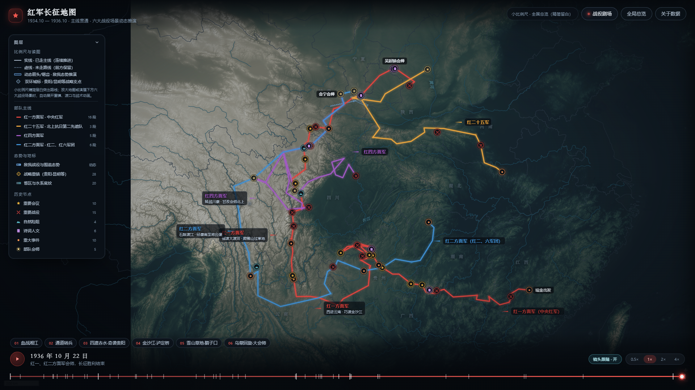
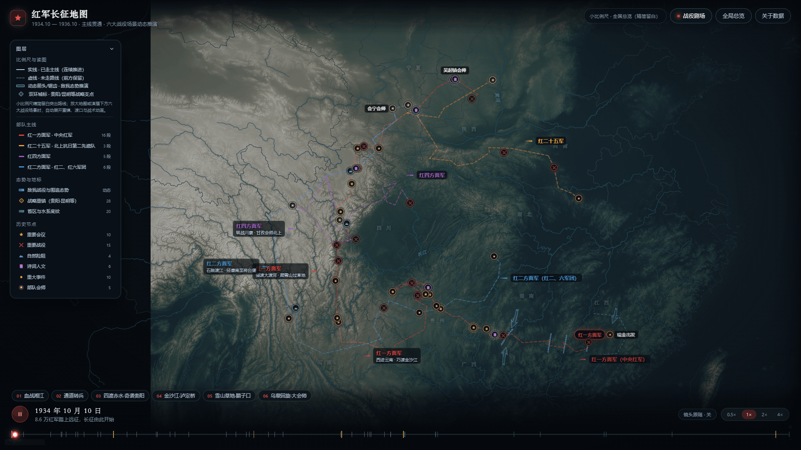
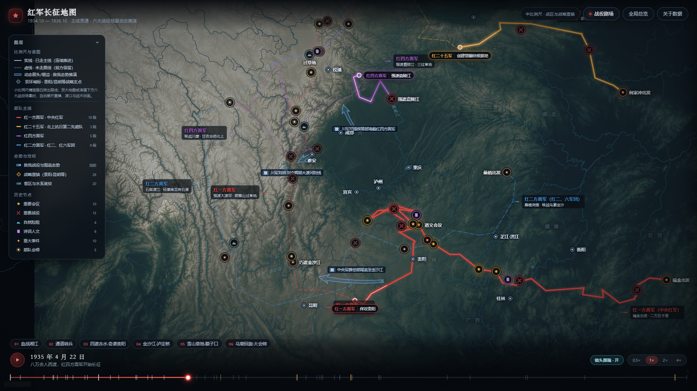
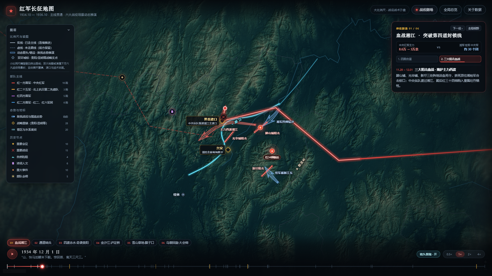
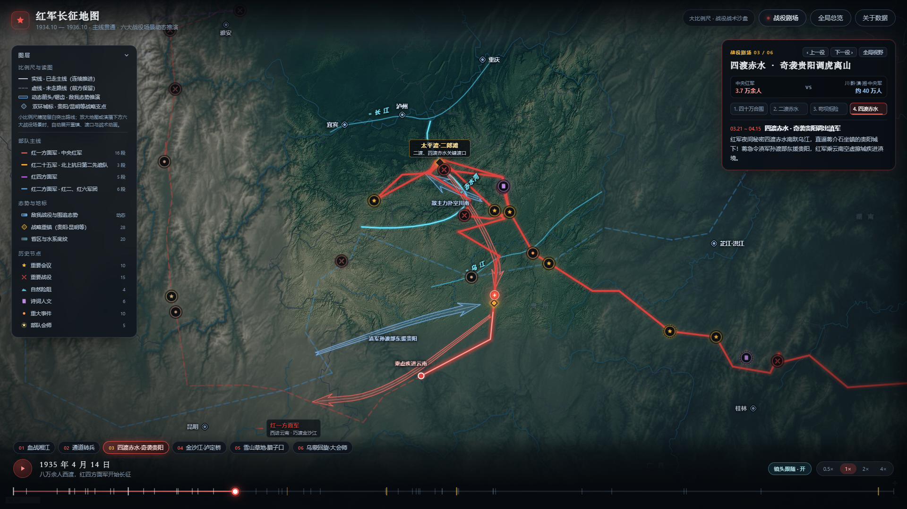
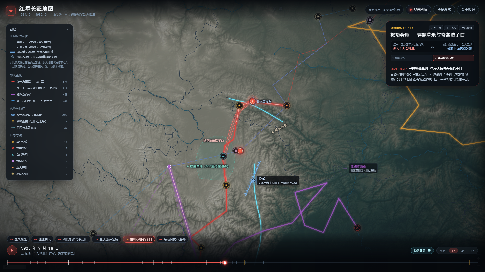
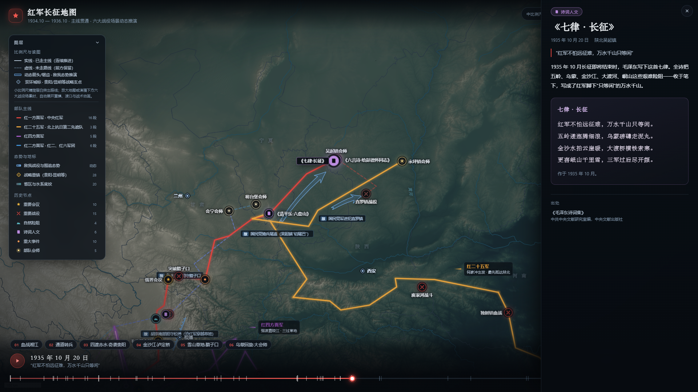

# 红军长征地图

一张可以推演的红军长征地形图。四支主力部队的行军路线、50 个关键节点、六场决定命运的战局，都挂在同一条时间轴上——时间走到哪一天，队伍就走到哪里。



*总览：从于都河畔出发的四支队伍，最终在西北会师。一条走廊，两年。*

## 这是一个什么项目

长征是一段在真实山川里走出来、打出来的历史：翻哪座山、渡哪条河、抢哪个渡口，往往直接决定几万人的生死。常见的呈现方式，是书页里一条红线穿过一串地名——路线很清楚，但「这条线为什么这样绕」不清楚。

这个项目想把两者一起交到读者手上：打开就是一整幅中国西南的地形沙盘，山脉的起伏、河谷的走向、省界与要塞都在；拖动时间轴，队伍沿着真实地形一段一段往前走，走过的路在身后点亮，未走的仍是虚线；每一个节点都可以点开，读到那一夜里发生了什么，哪一句是原话，数字从哪里来。

它不追求仿真战场，也没有把历史包装成游戏：**地形是主角，时间是主轴，史料是内容**，三者指向同一件事——让人用眼睛看见「长征是怎么走过来的」。

- **空间是真的**：为什么必须翻越夹金山、为什么泸定桥要「飞夺」、为什么松潘草地绕不过去，在地形上都有直接的答案；
- **时间是连续的**：1934 年 10 月到 1936 年 10 月，743 天连成一条可以任意拖动的轴，而不是一章一节地跳；
- **尺度是可换的**：从四支部队的全貌，一路拉近到一场战役里双方兵力的走位，看的是同一张图。

## 看着它走



*按一次空格，十四个月开始流动：光点沿着路线前行，身后的实线是已经走过的路，前方淡线尚未抵达。*

播放速度可以调到 0.5 倍慢看，也可以 4 倍快进；右下角始终写着「截至此刻，最后发生的一件事」，即使不看地图也知道走到了哪一步。想直接跳到某个事件，点节点，镜头会自己找过去。

## 三种看法

**一、总览——先看全局。** 四支队伍以不同颜色区分，各自的路线、出发地、会师地在同一屏里可见；谁在什么时候走到了哪里，一眼能比出来。

**二、拉近——看一次机动。** 放大地图，路线让位给具体的行军注记与战略重镇：贵阳、昆明、泸州、松潘这些左右过决策的城市，以及每一次渡口与要隘。



*拉近一档：从「四支队伍」变成「这一支正在怎么走」，重镇与要隘在此刻进入视野。*

**三、进战场——看双方。** 点「作战态势」进入战役级视图，镜头切换到更清晰的地形，红蓝双方的兵力、箭头、阻击阵地与运动方向按阶段展开，配上当时双方的兵力对比。



*血战湘江（1934.11.25 ~ 12.01）：8.6 万对约 30 个团，三十公里渡口上的生死阻击。*



*四渡赤水（1935.01.19 ~ 04.16）：3.7 万对约 40 万，四次渡河把追兵调开，声东击西跳出铁桶阵。*



*雪山草地·腊子口（1935.06.12 ~ 09.20）：松潘被锁死后，六百里沼泽与甘南咽喉的取舍。*

> 还有一段完整演播（镜头会自己推进、按阶段切换战场，文件较大，点开查看）：[四渡赤水态势演播](docs/screenshots/08-demo-sidu-chishui-theater.gif)

## 六场战役

| 战役 | 时间 | 一句话 |
| --- | --- | --- |
| 血战湘江 · 突破第四道封锁线 | 1934.11.25 ~ 12.01 | 三十公里渡口死守，8.6 万锐减至 3 万余人 |
| 通道转兵 · 智取遵义 | 1934.12.11 ~ 1935.01.17 | 放弃北上钻袋之危，西折入黔迎来转折 |
| 四渡赤水 · 奇袭贵阳 | 1935.01.19 ~ 04.16 | 3.7 万对 40 万，声东击西跳出合围 |
| 巧渡金沙江 · 强渡大渡河飞夺泸定桥 | 1935.04.24 ~ 06.02 | 七船巧渡甩开追兵，昼夜 240 里夺铁索天险 |
| 懋功会师 · 穿越草地与奇袭腊子口 | 1935.06.12 ~ 09.20 | 胡宗南锁死松潘，踏过六百里沼泽夺取甘南门户 |
| 乌蒙山千里回旋 · 三大主力西北大会师 | 1936.02.21 ~ 10.22 | 甩开十万围堵渡金沙，会宁、将台堡胜利会师 |

## 读一个节点



*点开任意一个节点，右侧展开的不只是结论：那一天发生了什么、双方各有多少人、原话怎么说的、出自哪本书。*

50 个节点里有重要会议、有战斗、有渡口，也有诗词——「雄关漫道真如铁，而今迈步从头越」写在哪一次战斗之后，在地图上是能指出来的。

## 操作

- `空格` 播放 / 暂停时间轴，`Esc` 关闭面板；
- 拖动底部时间轴或点节点，可跳到任意一天；
- 左侧面板可按部队、按节点类别单独显示或隐藏；
- 滚轮缩放：越靠近，看得越细，行进也自动放慢，细节不会被一闪而过。

## 关于史料：不确定的东西不装成确定

每个节点与每段路线都标了两个信息：**可信程度**与**出处**。

通行说法但各资料有出入的地方（例如黎平会议是 12 月 18 日还是 28 日），节点外圈会显示一圈金色虚线，详情里把分歧摊开写。这是这个项目的基本要求——**宁可承认不确定，也不把猜测写成史实**。

地图上的点位是**示意坐标**：依据今天的地名定位，误差约 ±5~15 公里，属于叙事用的空间参照，不是测绘成果。详见[数据来源与可信度](docs/01-data-sources.md)。

## 在本地打开

```bash
npm install
npm run dev
```

不需要联网，不需要任何地图服务密钥：地形底图与地理数据随项目一起提供，打开即是完整的样子。

## 数据来源

- 中共中央党史研究室《中国共产党历史》第一卷
- 曲爱国、张从田《长征记》（华夏出版社 2016）
- 人民网·中国共产党新闻网党史资料
- 新华社「纪念中央红军长征出发 90 周年」系列报道（2024）
- 《毛泽东诗词集》（中共中央文献研究室编）

地形与水系、省界数据来自公开地理数据集，处理方式与误差说明见[数据来源与可信度](docs/01-data-sources.md)。

## 说明

本项目是一件历史地理可视化作品，史料梳理未经党史专业机构审校。它适合作为公众理解长征的空间叙事载体，**不宜作为学术引用来源**。如发现史实或坐标错误，欢迎提 issue 或 PR——数据按条目组织，每条都带出处，便于逐条校订。

设计与实现上的取舍（视觉方向、图层与交互设计、数据整理方式）另见 [设计说明](docs/02-design.md) 与 [技术选型](docs/00-tech-stack.md)。
